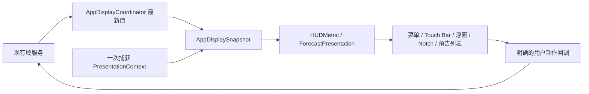

# 应用生命周期与呈现职责

应用保留 macOS 11 部署目标、SwiftPM 5.8 清单，以及现有额度、任务和公共重置预告的数据来源与计算规则。入口仍由 `main.swift` 在创建 AppDelegate、服务和界面之前取得单实例锁。

| 对象 | 职责 |
| --- | --- |
| `AppDelegate` | 创建服务与协调器，连接回调，转发 AppKit 和 workspace 通知；把额度更新交给提醒监测与显示协调器。 |
| `AppLifecycleCoordinator` | 服务启停、宿主与 Codex 运行事实、会话暂停、退出原因及异步退出收尾。 |
| `AppLifecycleState` | 无副作用的生命周期状态转换；明确重复事件、重叠暂停和停止后的迟到事件。 |
| `AppDisplayCoordinator` | 保存最新域状态与诊断引用，管理完成反馈，生成显示快照，分发到各表面，处理面板模式、显隐和预告弹窗路由。 |
| `StatusMenuController` | 状态按钮和菜单创建、菜单 validation、动作转发、更新条目；摘要内容与尺寸决策仍由 `StatusSummaryView` 管理。 |
| `PreferencesCoordinator` | 设置、Hook 实验和连接诊断窗口，连接设置动作；更新、预告、提醒和自启动设置仍调用各自现有服务。 |
| 原有服务与界面控制器 | `RateLimitStore`、`TaskMonitoringCoordinator`、`ResetNewsMonitor`、`AppUpdater` 等维持业务职责；Notch 控制器保留几何、动画、页面和可见性判断。 |

## 单向状态流



`AppDisplaySnapshot` 用只读字段保留该轮额度、任务、预告、上下文和呈现值。`PresentationContext` 一次捕获时间、显示语言、日历与时区；`HUDMetric`、Notch 内容适配器、日期格式化和公共预告构建器复用这份上下文。额度、任务、公共预告以及监测器发布的日历/时区变化都走这次统一分发；各表面保留自己的布局职责。

- 菜单更新保存最新快照；关闭菜单时不重建摘要布局。打开菜单会刷新上下文。
- 浮窗与 responder Touch Bar 从 `CompactHUDViewController` 接收相同状态和上下文；视图延迟加载时使用控制器缓存的上下文。
- 常驻 Touch Bar 缓存额度状态、上下文及完整 indicator，在系统稍后创建 item 时一起交给视图。
- Notch 的额度内容和预告投影来自同一快照；数据刷新不会选择页面或重置几何动画。
- 弹窗和 Notch 列表共享预告卡片投影；打开弹窗时更新一次上下文，沿用监测器已有跨日、时区与到期发布，不新增界面轮询器。

诊断引用更新只替换最新引用，不触发显示分发；下一次实际刷新仍能使用该引用。渲染器比较可见内容，诊断时间戳和引用不参与视觉相等判断。新的 `now` 若没有改变输出，也不会单独发布 Notch 或弹窗模型变化。

## 呈现与交互不变量

`ResetForecastHeadline.Kind` 区分未知、精确时刻、完成截止、时间区间和仅日期；`Day` 区分今天、明天和其他日期。菜单与 Notch 不再从中英文文案反推时间类型。精确 `20:00` 与 `By 20:00` 保持不同含义，跨日、跨年和 DST 区间保留必要日期及偏移量。

`ForecastPresentation` 分开表达列表入口、具体详情和重试能力。公开预告与账号额度保留各自新旧状态、检查时间和动作：成功空结果可以显示确定的 0；缓存空结果与未知结果显示 `—`。`ForecastIndicatorPresentation` 保留缓存标识、完整数量、紧凑标题、tooltip 与辅助功能文本；紧凑数量可显示 `99+`，辅助功能仍保留完整数量。相同数量的缓存到最新状态更新不会被丢弃。

菜单仍按实测文本宽度决定双列、整行与必要换行；Touch Bar 维持局部图标和数量强调，窄布局使用短标题与完整辅助文本。预告详情可滚动；刷新不抢页，只有当前可见页面内与 viewport 相交的卡片才触发已读。菜单打开预告仍先取消 tracking、异步展示，并保留返回菜单动作；设置仍定位到对应 tab。

## 生命周期与退出不变量

宿主运行事实与 Codex 运行事实独立。`quotaAlertsAllowed` 只控制额度提醒的暂停与恢复；`RateLimitStore` 保留原有采集生命周期和手工刷新行为，不因锁屏而新增停采集逻辑。公共预告的运行门禁使用 Codex、HUD 和暂停事实；功能开关仍由预告服务自身处理。

锁屏、系统睡眠、会话 inactive 分别记为暂停原因。只有最后一个原因解除时才恢复任务监测和允许相应提醒/预告工作；宿主重启或任务设置变化也不能绕过尚未解除的暂停原因。start/stop 幂等；停止先关闭 runtime gate，再停止服务与显示，迟到通知不能重新启用它们。

手工、更新及宿主退出都先检查更新安装的 `canQuit`。安装拒绝退出时，显示安装进度并保留 runtime 与显示；宿主/Codex 事实和相关门禁仍更新。这修正了原先宿主退出在 AppKit 检查安装保护之前先停服的顺序。允许退出后，旧菜单动作、延迟弹窗与设置窗口入口被关闭。

AppKit 退出桥接保留三秒 deadline、预告缓存 flush、诊断退出原因及 `MainRunLoopCompletion`。后者在主 run loop 上 exactly-once 回复 `reply(toApplicationShouldTerminate:)`；重复请求继续返回 `terminateLater`。

## 验证与边界

本轮日志、失败记录、源码摘要和原生 fixture 截图保存在本工作树忽略目录 `build/presentation-coordinators/`；`final/validation.json` 汇总结果、对应源码及未通过检查。`final/` 保存最终代码的回归和构建记录；`stage1/` 至 `stage3/` 保存阶段检查。该目录是本机证据，未纳入提交。检查入口可在其他 checkout 重跑：

```sh
python3 scripts/ci_regression.py --suite data
python3 scripts/ci_regression.py --suite interface
bash scripts/test-unified-diagnostic-task-trace.sh
bash scripts/test-reset-news-date-card.sh
bash scripts/test-reset-news-popover.sh
bash scripts/test-release-workflows.sh
bash scripts/build-app.sh
```

CI data suite 新增 `test-app-termination`，它运行原有四个原生退出场景及真实 `AppLifecycleCoordinator` 的 `terminateLater → reply → applicationWillTerminate` 检查。状态 reducer 接入 `test-host-lifecycle`；canQuit、停止入口和固定上下文的实际表面检查接入 `test-status-menu`。历史 suite 入口顺序仍有测试校验。新协调器、共享预告呈现、`LimitModels.swift` 中的共享上下文和相关生命周期测试路径按高风险改动处理。

本机验证不能替代实体 Touch Bar、真实刘海硬件、macOS 11 运行时或另一架构 runner 验收。阶段 1 的原生弹窗焦点检查曾出现一次重开失败：原始 `6956bec` 隔离对照和同一候选二进制随后各通过一次，原因未确认；保留失败与对照日志，不将其标记为已修复。

最终原生鼠标路由检查受到当前桌面环境阻断：原始 `6956bec` 与同一候选二进制均命中另一应用的窗口，而非 fixture panel；窗口归属记录确认为腾讯会议的 layer 1001 窗口。保留原始失败、一次隔离对照与窗口记录，未更改生产路由或测试断言，也未关闭用户窗口。当前屏幕的弹窗复测通过 93 项；此前包含外接屏的 145 项与偶发重开失败仍各自保留，不将本次单屏结果扩大为外屏验收。窄 Notch 截图使用独立绘制入口，不包含真实鼠标输入检查。

原有材质 fixture 将左右入口都视为白色图标；它在原始 `6956bec` 和候选代码上均因右侧无预告入口而失败。现保留左白图标及材质/宽度矩阵，按既有产品规则检查无预告时右入口不出现、当前和缓存预告分别以强调色和缓存色可见。修正后 76 项通过，原始失败保留。固定上下文的共享辅助文本有严格断言；本机 SwiftUI 未暴露 8 个原生 AX 节点，其原生 label 读取记录为不可用，不计作通过。
