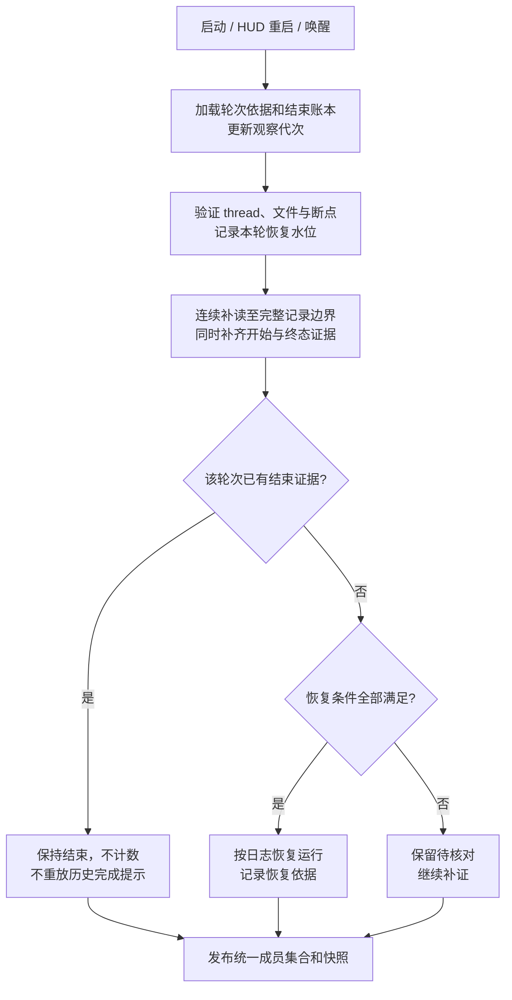

# 任务状态恢复优化方案（以 0.1.38 为对照）

2026-10-12 · 历史设计稿。下文保留当时的方案与验证边界。2026-10-13 合入的任务恢复实现已采用开始依据核验、补读完整记录边界及终态否决等规则，纳入 v0.1.44；系统睡眠时长补偿和更强的来源进程身份适配尚未完整实现。当前行为与验证见[安装后验证记录](TASK-MONITOR-INSTALLED-VALIDATION-2026-10-13.md)，不能将本文所有建议视为已交付。

建议在现有连续读取引擎上增加**轮次恢复核验**：启动、HUD 重启和唤醒后，先读完恢复区间，再恢复有完整开始依据、尚未结束的轮次；已确认结束的轮次持久保留结束证据，阻止迟到事件重新计数。

这是对 10 月 8 日方案中“恢复后必须出现本观察代次的新 start”的修订建议。旧方案和实施记录保留为历史；本文获得确认前不改变现有行为。

## 1. 目标与口径

- 本机一个独立主聊天最多计一次，按来源和 thread 身份去重；子代理不增加主计数。轮次用 turn 身份区分。
- HUD 启动、重启、升级重启、监测模式切换或睡眠唤醒后，符合恢复条件的原轮次自动回到计数中，不要求用户重发消息。
- 已确认完成或中断的轮次不能被工具结果、Token 更新、重复回调或重复开始记录重新计为运行；同一聊天的新轮次正常计数。
- 启动和恢复不重放历史完成提示。四个展示端使用同一份成员集合和快照。
- 读取、解析或库存尚未核验完毕时保持待核对；无法确认不等于确认没有任务。

本方案默认继续使用本地日志判断。完整日志只能证明“有开始且截至所读位置未结束”，不能证明宿主此刻仍在执行。若实际任务已经结束但终态尚未写入、永久缺失，或在别的宿主执行，纯日志无法同时保证绝不漏计和绝不误计。本文严格保证的是**已取得结束证据的轮次不复活**；其余恢复计数标记为日志推断，不冒充宿主实时真值。

## 2. 0.1.38 的可取之处与不能继承的行为

对照版本和本轮核对基线：

| 版本 | 源码提交 | 用途 |
| --- | --- | --- |
| 0.1.38 | `382f49390ec2cb7b50beceea44307530a862806d` | 用户反馈最稳定的行为对照 |
| 0.1.41 | `2ebb8b1ca9060867c0571657dddc7f2adeef4d3f` | 上一轮用户明确提供的比较版本 |
| 0.1.42 | `9acf390746ae378881a1de80928d712250960fb9` | 本方案的现有生产实现基础 |
| 当前 main | `02af43a3aa623fc7c2e04c24de0fde9e32b8ef14` | 本轮只读核对位置；包含发布证据文档 |

0.1.38 会用近期工具或 Token 活动补足缺失的开始记录，因此更容易在中途启动时出现任务数。它也允许某些不同 turn 的弱事件把结束状态改回运行，存在旧后台工具结束后误计的风险；此外仍有 256 KiB 跳读和最近 32 个候选的边界。

上一轮使用各版本生产逻辑做过 3 组合成事件对照，9 个输出均符合下表。本轮重新读取结果和对应源码，没有新增实机实验。

| 合成输入 | 0.1.38 | 0.1.41 | 0.1.42 | 本方案目标 |
| --- | --- | --- | --- | --- |
| 已开始，随后出现无 turn ID 的 Token 统计 | 运行 | 降为未知 | 保持运行 | 保持 0.1.42 行为；该统计不改变状态或证据时效 |
| 只有工具活动，输入范围内没有开始 | 运行 | 未知 | 未知 | 启动有界回溯；找到完整依据才恢复，找不到仍待核对 |
| 两轮均已完成，旧轮次工具结果迟到 | 错误运行 | 保持完成 | 保持完成 | 保持完成，跨重启也不能复活 |

对照方法有明确边界：0.1.38 调用当时 cursor 的 `consume`；0.1.41/0.1.42 运行隔离 SQLite/JSONL 中的完整引擎。事件次序和相对时间相同，绝对时钟分别取各次运行时间；没有验证 UI、真实 Hooks 投递或用户故障现场，不能据此得出总体准确率。

## 3. 当前漏计发生在哪里

| 当前源码位置 | 已核对行为 | 对恢复的影响 |
| --- | --- | --- |
| `HookCore/TaskActivityEngine.swift:95`、`:113`、`:427` | begin、休眠及恢复调用 demote，把 active 留作 lastKnown 并降为 unknown | 读取断点恢复成功，运行资格仍丢失 |
| `HookCore/TaskActivityEngine.swift:377` | start 必须晚于本次 observationStarted，且不在历史区间 | 启动前已开始的同一轮次不能成为 active |
| `HookCore/TaskActivityEngine.swift:386` | 弱事件仅维持本代次已确认的 active | 被降为 unknown 后没有补证恢复入口 |
| `Tests/TaskReliabilityIntegrationTests.swift:275`、`:287`、`:299` | 现有测试要求重启和模式切换后运行集合为空，历史 start 加当前工具活动仍为空 | 测试通过证明了旧取舍，未证明“原任务自动恢复” |
| `Sources/HostLifecycleMonitor.swift:3` | 宿主快照只记录两个是否运行的布尔值 | 不能单独区分“原宿主仍在”与“宿主已换进程” |
| `HookCore/TaskCheckpointStore.swift:5` | 状态、轮次、位置和去重信息已经持久化 | 可以扩展恢复依据，无需重建整套监测 |

现有连续读取、分页库存、后台串行执行、文件锚点、旧回调隔离和统一展示保留。0.1.42 对无 turn ID Token 统计的修正也保留。此次重点是恢复判定及其测试契约。

## 4. 状态与恢复资格分开

内部保留两个维度：

| 维度 | 建议内容 | 用途 |
| --- | --- | --- |
| 轮次生命周期 | 有明确开始、完成、中断、无法建立轮次 | 表示日志已证明的业务事实；HUD 重启不改写这些事实 |
| 观察质量 | 正常、正在补读、待核对、读取不可用 | 表示当前结论是否已核验到目标位置 |

计数来源另外记录为 `liveStart`、`journalRecovered` 或未来的 `verifiedHost`。前两者都是日志判断；字段名不代表宿主实时确认。待核对记录保存最后状态和原因，不直接计入当前运行集合。

将三种代次明确分开：

1. **观察代次**：HUD 重启、暂停恢复、模式切换时更新，只用于取消和丢弃旧回调。
2. **来源运行代次**：用于识别宿主或执行来源是否确已重启。设计上由独立适配层提供，不能把观察代次当作来源重启。
3. **日志文件代次**：轮转、截断和重写时更新，用于验证连续读取。

宿主应用的 PID 加启动时刻可以辅助识别更换进程，但不能证明某个 thread 在运行，也不能自动代表其内部 app-server 没有重启。来源关联不可靠时记录 unknown；`cli`、`exec`、`vscode` 不凭字符串绑定到某一个桌面进程。来源适配层是否可取得足够身份，要在实现前的只读检查中验证，不能将其当作已有能力。

### 可恢复运行的条件

普通日志模式同时满足下列条件，才把待核对轮次恢复为运行：

1. thread 和 turn 身份有效，属于目标主聊天；原始开始记录已经核验，或由可靠断点证明此前已核验该记录。`lastKnownPhase=active` 本身不算依据。
2. 开始记录之后至本次恢复水位的生命周期链连续、已读完完整记录，没有尚未排除的坏记录、文件代次冲突或遗漏区间。
3. 结束账本和补读区间中均没有该轮次的终态，也没有已接替它的较新轮次。
4. 具有仍在有效期内的、能够归属该轮次的开始或活动证据。首版沿用 30 分钟新鲜度上限，恢复时不把时钟重置为“刚发生”。
5. 没有已知来源重启、身份冲突或当前宿主状态与之矛盾的证据。

上述条件允许历史 start 参与恢复，并不允许一条工具事件单独创建轮次。来源运行代次未知时，只能得到 `journalRecovered` 的推断结果；保留此不确定性。已知来源重启会否决旧运行资格，必须取得重启后的明确执行依据才能计数。

**30 分钟边界**：首版不扩大现有阈值。超过阈值后转为待核对并主动重新核验；同一未结束轮次随后出现有效活动、且完整链重新通过核验，可以自动恢复，不必等待新的 start。无 turn ID Token、mtime 变化和重复旧事件不能续期。长时间静默且没有可用宿主状态的任务仍可能漏计，这是保留的明确限制。

## 5. 启动、重启和唤醒分别处理

| 场景 | 恢复路径 | 对用户的预期行为 |
| --- | --- | --- |
| Codex 已有任务，首次启动 HUD，无断点 | 优先发现近期主聊天，连续回读到有效开始及其后的完整区间；从流式解析构建轮次依据，再按上述条件判定 | 近期真实运行任务可恢复，无需重发消息；仅见工具尾部时继续补证 |
| 只重启 HUD，或升级重启，Codex 保持运行 | 校验断点与文件身份，从 committedOffset 补读；保留原始开始依据和结束账本 | 同一轮次可恢复；即使恢复后暂时没有新日志，也不强制等一个 start |
| 监测模式切换 | 复用同一断点和结束账本，只更新观察代次，执行相同核验 | Hooks 与普通模式不改变同一证据的计数结果 |
| 休眠唤醒，来源未重启 | 补读睡眠期间和唤醒后已经落盘的记录，先处理终态，再发布恢复集合 | 睡前运行且仍符合条件的任务恢复；睡眠期间已完成的任务不会先闪回运行 |
| Codex/执行来源确已重启 | 旧轮次保留历史事实，当前运行资格待核对；接收新执行依据 | 不因重启前缺少结束记录而继承旧数 |
| 日志损坏、轮转或断点失效 | 仅对受影响 thread 重建；结束账本仍作为否决依据 | 其他任务正常更新；不把缓存错误扩散为全局归零 |

睡眠不应直接消耗任务的新鲜度预算。只有实际记录了 sleep/wake 配对、能确认同一系统启动周期且来源连续时，才扣除已知睡眠时长；先补日志，再应用剩余预算。不能从“很久没记录”猜测一直在睡眠。配对缺失、来源重启或身份不明时使用保守时效规则；系统重启不视为一次普通睡眠。

### 一次恢复的执行顺序

- 恢复扫描只更新候选状态；不能读到历史 start 就先发布一次运行、读到后面的 complete 再撤回。
- EOF 指一个捕获的水位，不等于文件永远停止增长。完成该批次后检查新增长，继续公平调度；不要求高输出任务无限等待文件静止。
- 必须读至可确认的完整记录边界。捕获水位处有半行时，保留待核对并等该行写完，不能用 fetchedOffset 到达 EOF 代替完整解码。
- 任务可分别收敛；一个巨型文件不能阻塞其他任务。每次对外发布都是一份一致的身份集合，内部另带恢复中成员集合和覆盖状态。
- 冷启动不退回 256 KiB 尾部猜测。近期、断点中未结束及收到有效发现提示的任务优先，其余任务公平补扫；预算耗尽续读，不跳过记录。

## 6. 防止终态复活

为每个 `(来源域, threadID, turnID)` 保存必要的结束元数据：完成或中断类型、日志文件身份和结束位置。它与完成提示去重分开；提示窗口结束不能删除防复活依据。

| 输入 | 状态规则 |
| --- | --- |
| 当前 turn 的有效完成或中断 | 关闭该轮次并写入结束账本；从运行集合移除 |
| 已关闭 turn 的工具/Token 活动 | 忽略状态和续期，记录固定拒绝原因 |
| 已关闭 turn 的重复 `task_started` | 不重新打开，仅靠重复 start 或较新的接收时间不足以证明新执行 |
| 同一 thread 的新 turn 有明确 start | 建立新轮次；旧轮次仍关闭，聊天最多计一次 |
| 旧 turn 终态晚于新 turn 到达 | 补记旧轮次结束，不结束当前新轮次 |
| 无 turn ID Token 统计 | 忽略生命周期；不把有效的会话级统计当坏记录 |
| 只有弱事件，找不到 start | 保持待核对并尝试补证，不直接计数 |
| 完成之后发生文件轮转或断点重建 | 已验证结束依据仍保留，不能因 reader 重建自动忘掉它 |

同一 turn ID 在终态后是否可以合法再次执行，不能仅凭当前日志猜测。首版不开放“同 ID 终态重开”；只有未来能够证明新的执行实例时，才增加执行实例标识和单独规则。**未到终态的同 turn 明确继续执行不受这一限制。** 这一点会比旧实现更严格，必须作为兼容性检查项。

事件排序优先使用同一已验证日志中的记录位置；墙上时间用于时效校验，不作为跨来源的全局顺序。系统时钟回拨不能让已经读到的匹配终态被简单丢弃。重复记录、旧轮次、不同文件代次及不可比较的来源分别处理，不能以“后收到”统一覆盖。

结束账本在冷启动时由有效历史链重建，在 HUD 重启时从断点恢复。内存可以缓存近期项，但淘汰缓存不得删除仍需防重放的磁盘依据。首版延用有界存储策略；遇到容量限制时受影响任务待核对，不能为了腾空间忘掉旧终态后继续接受它。是否另建索引文件，在实际体积测量后决定，不能借此引入无限增长的日志副本。

## 7. 实施范围与展示

| 模块 | 拟议调整 |
| --- | --- |
| `TaskActivityEngine` | 分开观察质量和轮次事实；新增统一恢复核验；历史依据通过核验后可恢复；终态否决优先；完善按记录位置处理事件 |
| `TaskCheckpointStore` | 新 schema 保存开始依据、结束账本、恢复水位及必要的来源/睡眠元数据，与已提交读取位置原子保存 |
| `TaskJournalReader` | 复用连续读取和锚点；向恢复层明确完整记录边界、半行及代次变化，不能只看 fetched EOF |
| `TaskEngineController` / `TaskMonitoringCoordinator` | 把冷启动、HUD 重启、模式切换、唤醒和已知来源重启分别传入；继续保留旧回调取消门禁 |
| `HostLifecycleMonitor` / `AppDelegate` | 提供可验证的宿主更换与 sleep/wake 事实；不能由应用存活直接判定任务运行 |
| 生产诊断和恢复测试 | 记录每个恢复/拒绝的匿名原因；修改“恢复后必须为空”的旧断言，加入恢复身份集合契约 |

旧 checkpoint-v1 缺少的新资格字段不能补默认值后直接当真。迁移仅复用能校验的元数据，必要时重读相关历史；保留旧文件直至新格式成功落盘，不改变 Codex 原始文件。新格式仍不存正文、工具参数或回复。

主界面沿用现有普通模式样式，不增加问号、错误行或诊断 tooltip。恢复未完成时采用现有中性状态；不先展示未经核验的旧数字，也不产生“已完成”反馈。已核验成员按原样展示。内部必须分开“已确认空集合”和“还有待核对成员”，排查时能够看出区别。

诊断复用现有本地记录器，新增固定原因，例如：断点续读恢复、历史链恢复、来源已更换、已结束轮次被拦截、缺少开始、存在日志缺口、证据过期。记录匿名任务、前后状态、观察代次、读取位置和快照编号；不记录标题、原始身份、路径或正文。

## 8. 验收设计

以下均为拟定目标，尚未实施或验证新行为。比较顺序是独立任务身份集合、数量、恢复延迟，再检查 UI；不能用总数恰好相同掩盖错认任务。

| 用例 | 新契约 |
| --- | --- |
| task_started 在 HUD 启动前，任务仍持续执行 | 补齐完整链后计入原 turn；不生成新 start |
| 有效断点中有运行任务，仅重启 HUD，恢复后没有新输出 | 在时效条件内通过补读核验后恢复同一集合 |
| 停机期间完成，随后旧工具结果迟到 | 恢复后不计数，过程也不能闪回运行 |
| 睡前 3 个主任务，唤醒时 1 个已完成、2 个仍在执行 | 核验后准确保留这 2 个身份；不播放睡眠期间的完成提示 |
| 长时间睡眠，可靠 sleep/wake 配对且来源连续 | 扣除已知睡眠时间后判定，不因睡眠时长自动过期 |
| 来源重启、进程身份复用、缺失 sleep 配对 | 旧状态不自动继承；来源未知不能伪称已验证连续 |
| 结束后相同/不同旧 turn 的工具、Token、重复 start 迟到 | 全部不复活已结束轮次；新 turn 的真实 start 仍能计入 |
| 只有工具事件，向前可找到 start / 找不到 start | 前者完整核验后恢复，后者待核对 |
| 半行、坏行、轮转、同 inode 重写、缓存损坏、写盘失败 | 仅降级受影响任务；不得跳读、伪造完成或遗忘终态 |
| 30 分钟静默后出现同轮新活动 | 触发补证；完整链通过后恢复；重复旧事件不续期 |
| 旧轮次终态乱序、系统时间回拨、恢复期间并发追加完成 | 当前轮次身份正确；完整匹配终态不因时间门禁遗漏 |
| 模式切换与 sleep/wake/stop 回调交错 | 旧回调无效；最新代次能完成恢复，不反复清空生命周期 |
| 1、3、8、33、65 个主任务及混入子代理 | 按预置身份集合验收；不被 32 项调度预算截断或重复计数 |
| 巨型输出覆盖 256 KiB、601,826 字节、2 MiB、16 MiB | 连续补读；终态及恢复不受分块影响，其他任务公平更新 |

性能目标先按现有引擎预算验收：每轮单文件 256 KiB、总计 2 MiB、32 文件、目标 100 ms 后让出工作队列；这些是工作配额，不是正确性截断线。

- 有有效断点、1–8 个主任务、每个补读量不超过 256 KiB 的普通恢复：目标 2 秒内发布核验结果。
- 无断点冷启动：单列读取量和耗时；先以 8 个候选、每文件不超过 2 MiB 为夹具，目标 10 秒内完成。更大历史不承诺固定秒数，但不能永久搁置。
- 主任务实时终态：在无积压的普通负载下目标 2 秒内移除。
- 上述时间是待测的验收目标；不得在达到时间上限时通过跳读或猜测计数“完成恢复”。

对照运行 0.1.38、0.1.42 和候选实现，使用同一组输入及独立真值，在各自真实读取链路中比较。0.1.38 的已知假阳性不作为候选实现必须一致的目标。重点恢复场景至少重复 20 轮，并分别在 arm64 与原 Intel 故障环境中对照宿主主聊天身份；编译通过和离线回放不能替代实机睡眠、升级重启或实体 Touch Bar 验收。

## 9. 后续执行顺序

1. 确认本文恢复计数采用“完整日志链推断”的口径，以及同 turn 终态默认不重开的边界。
2. 固定启动、HUD 重启、唤醒、离线完成和迟到事件夹具；先记录当前实现的恢复漏计，再实现最小的恢复核验与结束账本。
3. 补齐宿主代次、睡眠时效、迁移、异常和并发回调验证；不以未验证的同宿主状态接口作为实现前提。
4. 在独立试用包中按身份集合对照，确认自动化和现场效果后再决定发布。本轮未构建试用包、提交或发布。

将来若取得受支持、可证明属于同一宿主的只读状态源，可作为更强证据处理超长静默、等待审批、任务崩溃和日志终态缺失。现有源码只有来源准入边界，没有接入这种能力；本方案不把新启动的独立 app-server 或本次聊天的工具权限等同于分发 App 的可用通道。

本轮完成的是源码及既有证据核对、方案设计和文档检查。有关恢复准确率、时延、兼容性及实机效果的条目仍是验收要求，不是已取得结果。
