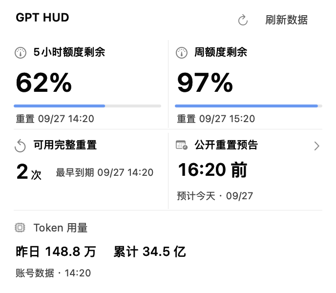
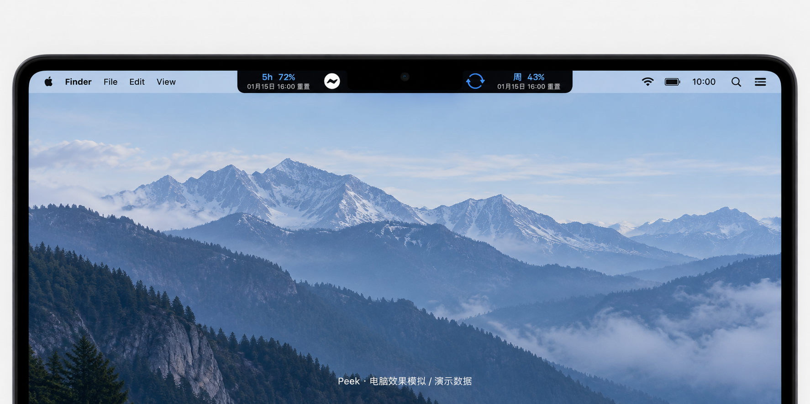
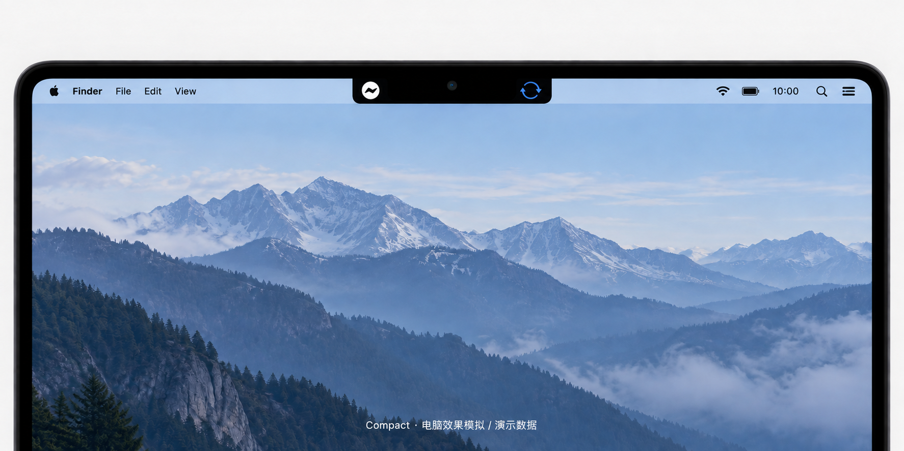
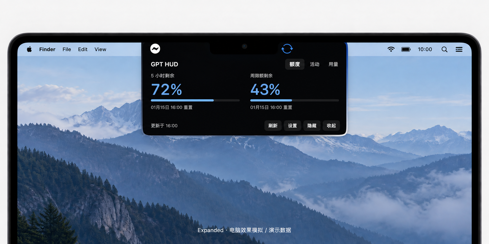
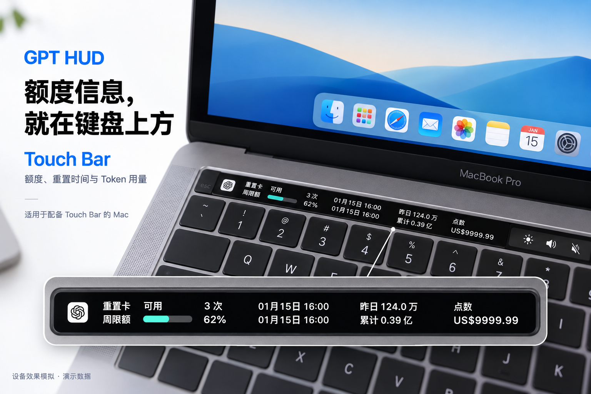

# GPT HUD

在 Mac 上随手查看 ChatGPT / Codex 的账号额度、重置时间与 Token 用量，无需 Touch Bar。

**[下载最新版本](https://github.com/zz-zed/GPT-TouchBar-hud/releases/latest) · [快速开始](#快速开始) · [选择展示方式](#选择展示方式) · [常见问题](#常见问题) · [反馈问题](https://github.com/zz-zed/GPT-TouchBar-hud/issues)**

> 宣传图为基于界面参考制作的 AI 生成示意，使用演示数据；设备、图标和排版细节以实际应用及下方界面对照为准。

## 快速开始

### 下载与安装

先将 ChatGPT、Codex 或 GPT 客户端安装在系统 `/Applications` 目录，并完成登录。仅在浏览器登录或单独安装 CLI，无法满足使用条件。

在“ → 关于本机”查看芯片或处理器，下载对应安装包：

| 你的 Mac | 安装包 |
| --- | --- |
| Apple 芯片 | `GPT-TouchBar-HUD-<版本号>-arm64.dmg` |
| Intel 处理器 | `GPT-TouchBar-HUD-<版本号>-x86_64.dmg` |

1. 从[最新 Release](https://github.com/zz-zed/GPT-TouchBar-hud/releases/latest) 下载 DMG 并打开。
2. 将 `GPT TouchBar HUD.app` 拖入 `Applications`，保留这个应用文件名。
3. 先启动并登录 ChatGPT / Codex，再打开 `GPT TouchBar HUD.app`。从旧版升级时，先退出旧版应用。

应用尚未经过 Apple 公证。首次打开如提示“无法验证开发者”，可运行安装包内的 `首次打开助手.command`，输入 `OPEN` 后回车；也可先尝试打开应用，再到“系统设置 → 隐私与安全性 → 仍要打开”。仅对你信任的安装包执行这些操作；如提示恶意软件或应用损坏，请停止打开，重新下载或反馈问题。

安装包的最低构建目标为 macOS 11，该版本尚未完成实机验收；本机客户端还可能要求更高版本。兼容性与安装验证范围见[发布说明](Documentation/RELEASING.md#验证边界)，安装包校验文件见最新 Release。

### 打开后看哪里

- 菜单栏会出现状态图标，Dock 不常驻图标，也没有需要一直打开的主窗口。
- 带刘海的设备首次使用时，默认在刘海两侧预览额度，点击可展开详情。
- 无刘海设备的桌面浮窗首次默认隐藏，可从菜单栏选择“显示状态面板”。

升级会保留已有的展示方式和显示／隐藏选择。应用可随 ChatGPT / Codex 启停；可在“设置 → 通用”关闭随客户端启动。

## 选择展示方式

根据设备和使用习惯，选择菜单栏、刘海面板、桌面浮窗或 Touch Bar。刘海面板与桌面浮窗可切换，核心额度功能不依赖 Touch Bar。

查看四种展示位置

## 界面与使用场景

### 菜单栏：完整摘要，随手打开

点击菜单栏图标，查看 5 小时与每周剩余额度、重置时间、Token 用量，以及账号提供的点数等信息。

适用于支持的 Mac。菜单栏内容可在“自动 / 仅图标 / 单额度 / 完整额度”之间选择。

查看菜单栏原生界面（演示数据）

### 刘海面板：看一眼额度，点击看详情

平时在刘海两侧预览额度和重置时间，点击后展开“额度 / 活动 / 用量”详情。

适用于带刘海的设备。在“设置 → 通用 → 刘海常驻形态”选择 Peek 常驻预览，或 Compact 精简指示器；后者悬停时再预览额度。任务状态变化不会自动展开面板。

查看刘海三种状态（电脑效果模拟／演示数据）

Peek：常驻预览额度与重置时间。

Compact：平时只保留精简指示器。

Expanded：点击后展开详情。

这些电脑图为效果模拟，非实机照片；原生界面参考见[使用指南](Documentation/USER-GUIDE.md#刘海融合面板)。

### 桌面浮窗：工作时，信息保持可见

将任务提示与额度放在桌面上，以单行胶囊显示，提供刷新入口。

适合无刘海设备，或偏好独立浮窗的用户。在“设置 → 通用 → 显示模式”切换到桌面浮窗；颜色和透明度可在“设置 → 外观”调整。本机 Codex 任务提示为实验性功能。

查看桌面浮窗原生界面（演示数据）

### Touch Bar：额度信息，就在键盘上方

在键盘上方查看额度、重置时间、Token 与点数，右侧系统控制条仍保留。

仅适用于配备 Touch Bar 的 Mac。常驻显示会占用其他 App 的左侧 Touch Bar 快捷按钮区域，可在“设置 → Touch Bar”关闭。

查看 Touch Bar 原生界面（演示数据）

## 主要功能

| 功能 | 使用说明 |
| --- | --- |
| 额度与重置时间 | 查看账号提供的 5 小时或每周额度、下一次重置时间、可用完整重置次数与点数；实际项目以账号返回为准。 |
| Token 用量 | 查看昨日与累计 Token，属于账号统计。 |
| 公开重置预告 | 查看当前有效的 Codex 公开预告及预计时间；预告不保证适用于当前账号，也不代表额度已重置。默认开启，提示音默认关闭。 |
| 个人低额度提醒 | 可为 5 小时与每周额度分别设置提醒阈值，默认关闭。 |
| 本机任务提示（实验性） | 查看本机 Codex 的执行中、最近完成或未知状态。默认开启，可在“设置 → 通用”关闭；不保证覆盖全部任务或提供准确进度，也不代表整个目标已完成。 |
| API 消费（可选） | 单独配置 Admin API key 后查看按 UTC 月份统计的本月消费，默认关闭。接入方法见 [API 消费说明](Documentation/API-COSTS.md)。 |
| 检查更新 | 自动检查默认开启，只提示可用版本；确认“安装并重启”后才下载安装，也可手动检查。 |

更多显示偏好、操作入口和快捷键见[使用指南](Documentation/USER-GUIDE.md)。

重置预告怎么看、去哪里设置

有有效预告时，点击菜单栏中的预告组，或按 ⌘⇧P 打开详情；也可从刘海、浮窗或 Touch Bar 的预告入口进入。

预告显示预计时间、时间待定或暂无预告。预告条数与账号可用完整重置次数是两种信息，公共预告不会替账号执行重置。自动重置与额外赠送的重置次数也会分开显示。

预告仅在 Codex 与 GPT HUD 同时运行且未休眠时检查。在“设置 → 重置预告”中查看或关闭提醒、调整提示音；“检查预告”与“刷新额度”是独立操作。

## 常见问题

打开后没有窗口，是不是没启动？

先查看菜单栏图标。应用不在 Dock 常驻，无刘海时桌面浮窗默认隐藏；从菜单栏选择“显示状态面板”。已保存的隐藏状态会保留，再次打开正在运行的应用可进入设置。

手动退出后，本轮 ChatGPT / Codex 运行期间不会自动重新打开 GPT HUD；本机客户端完全退出再启动后恢复联动。

为什么菜单栏只有图标，没有额度？

“自动”模式下，面板显示期间仅保留图标。需要常显额度时，将“菜单栏内容”改为“单额度”或“完整额度”。

为什么只有周额度，或一直显示 --？

不同账号提供的额度项目可能不同，只有周额度不一定是异常。`--` 表示数据缺失或暂时无法确认，不代表零额度；先确认本机客户端已登录并正常运行，再刷新额度。仍有问题时，可从“设置 → 通用”检查连接，或查看[数据排查说明](Documentation/DATA-AND-PRIVACY.md#额度与用量读取排查)。

Token 后的 *、任务状态的 ? 是什么意思？

`*` 表示刷新失败后保留的旧 Token 数据。任务状态的 `?` 可能表示实验性监测无法确认状态或覆盖不足；这些标记不代表零用量、零任务或任务已完成。任务提示不准确时，可在“设置 → 通用”关闭实验性任务提示。详细含义见[数据与隐私](Documentation/DATA-AND-PRIVACY.md#任务状态的读取与判断边界)。

为什么升级后刘海仍是 Compact？

升级会保留已有偏好。需要常驻预览额度时，到“设置 → 通用 → 刘海常驻形态”选择“额度预览态 Peek（默认）”。

为什么选择 English 后，设置仍是中文？

信息语言只影响额度与任务信息的文字、日期和数字单位，导航与设置保持中文。

首次打开受阻，或者想完整卸载怎么办？

首次打开按上方[安装说明](#下载与安装)操作。卸载前需处理自动启动项；启用过 Hooks 实验的用户还需清理对应配置，具体步骤见[卸载说明](Documentation/UNINSTALL.md)。

## 隐私与联网

- 账号额度与 Token 功能复用本机客户端登录状态，无需额外配置 API key，不保存客户端密码或访问令牌，不上传本机会话日志。
- 公开预告与更新检查需要联网。本机偏好与相关记录的保存、清理方式见[数据与隐私](Documentation/DATA-AND-PRIVACY.md)。
- 可选的 API 消费功能需要独立配置，接入与数据保存方式见 [API 消费说明](Documentation/API-COSTS.md)。诊断报告由你审阅后自行导出或复制，反馈时请勿提交账号凭据或完整会话内容。

实体刘海贴合、全屏、多屏、睡眠唤醒及正式安装路径中的完整自动更新流程仍待实机验收；Touch Bar 的可用性也可能受系统升级影响。遇到刘海适配问题时，可切换到桌面浮窗。

## 更多文档

| 文档 | 内容 |
| --- | --- |
| [使用指南](Documentation/USER-GUIDE.md) | 各界面、设置与常用操作。 |
| [数据与隐私](Documentation/DATA-AND-PRIVACY.md) | 数据含义、隐私与问题排查。 |
| [API 消费说明](Documentation/API-COSTS.md) | 可选消费统计的接入与使用范围。 |
| [更新说明](Documentation/UPDATING.md) | 更新、安装与失败恢复。 |
| [卸载说明](Documentation/UNINSTALL.md) | 自动启动项、偏好与实验配置的清理。 |
| [Hooks 实验](Documentation/HOOKS-EXPERIMENT.md) | 可选任务监测实验及覆盖范围。 |
| [项目目录与文档导航](Documentation/README.md) | 源码、测试、素材与维护文档的入口。 |
| [开发说明](Documentation/DEVELOPMENT.md) | 工作原理、构建与验证。 |
| [发布记录](https://github.com/zz-zed/GPT-TouchBar-hud/releases) | 正式安装包、变更说明与校验文件。 |

## 共享与许可证

欢迎[反馈问题](https://github.com/zz-zed/GPT-TouchBar-hud/issues)或提交 Pull Request。反馈时请说明应用与 macOS 版本、处理器和复现步骤；参与开发前请阅读[贡献指南](CONTRIBUTING.md)。

本项目遵循 [MIT License](LICENSE)。感谢 [jackchensky/TouchBarCodexToken](https://github.com/jackchensky/TouchBarCodexToken) 原项目提供的基础实现。
